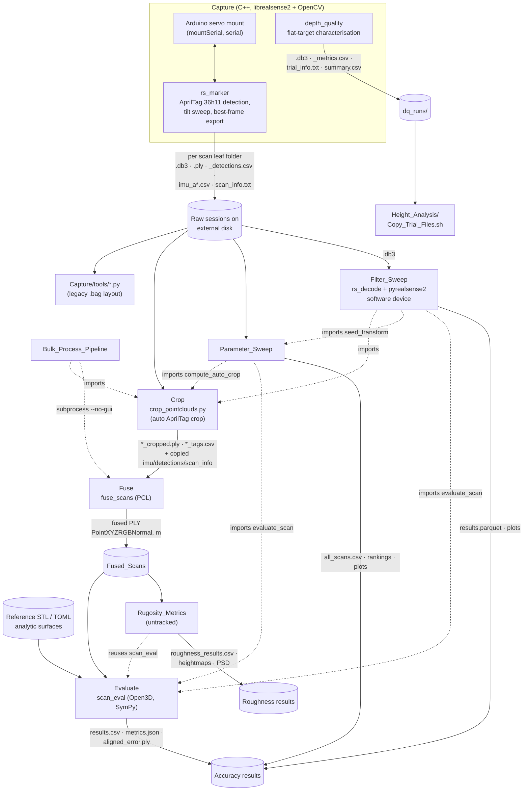

# 90 — Whole-system synthesis

This chapter draws together the component chapters ([01](01_capture_core.md)–[13](13_misc_scripts.md)). Facts stated here are cited in those chapters; citations are repeated only where a fact is used here for the first time. Throughout, **[EXPLICIT]** means backed by a comment, README or commit, and **[INFERRED]** means the auditor's reasoning. Nothing was run.

## Contents
1. Purpose and context
2. End-to-end data flow
3. Shared data structures and conventions
4. How the components interact (dependency graph)
5. Configuration model
6. Overall design rationale
7. Strengths
8. Weaknesses and risks
9. Consolidated observations (most important first)
10. Open questions

---

## 1. Purpose and context

The project measures the **3D shape and surface roughness** of small surfaces with an Intel RealSense D456 on a servo-driven tilt/rotation rig. It also quantifies how accurate those measurements are.

- **Application domain.**
  - The parent thesis folder contains a sibling project, `3D-SeaIce` ("3D Reconstruction of Pancake Sea Ice", `../3D-SeaIce/README.md:1`). Its `cpp/` folder matches the layout described in `Capture/README.md`.
  - The first commit says the capture code was "Existing RS_Code" (`8e07093`). The `/home/aru/...` paths in `Capture/README.md` and `Capture/run_both.sh` are consistent with code inherited from that project **[INFERRED]**.
  - `Processing/Rugosity_Metrics/README.md:3` describes the target as "a sediment bed" with ripples/bedforms **[EXPLICIT]**.
  - The test objects used for accuracy work are pyramids, wave/egg-carton forms and flat plates (from the Parameter_Sweep, Filter_Sweep and depth_quality chapters).
  - The best reading is that this is a laboratory roughness-measurement system for sediment/ice-like surfaces, validated on machined reference parts **[INFERRED]**.
- **Workflow.**
  1. **Characterise the sensor:** `depth_quality` on flat targets; Parameter_Sweep over hardware settings; Filter_Sweep over post-processing filters.
  2. **Capture multi-view scans:** `rs_marker`.
  3. **Crop and fuse them:** Crop, Fuse, Bulk.
  4. **Score accuracy** against known parts (Evaluate).
  5. **Compute roughness descriptors** (Rugosity_Metrics).

## 2. End-to-end data flow



ASCII summary of the main path:

```
D456 + servo rig
   │  rs_marker (per tilt angle a, per rotation r)
   ▼
<TS>/<TS>_r<r>/<TS>_r<r>_a<a>/{.db3, .ply, _detections.csv, imu_a<a>.csv, scan_info.txt}
   │  Crop: tag corners (bag intrinsics + depth) → bed plane → prism crop
   ▼
<leaf>_cropped.ply + <leaf>_tags.csv
   │  Fuse: load(voxel→SOR→normals) → tilt calib → rotation dir → coarse(rig|FPFH+RANSAC|tags) → ICP → weighted fuse → MLS
   ▼
<Session>.ply (fused)
   ├─ Evaluate: multi-start align to reference → exact distances → accuracy/completeness metrics
   └─ Rugosity_Metrics: level → crop → detrend → grid → ISO 25178 metrics, PSD, ACF
```

## 3. Shared data structures and conventions

| Artefact | Producer | Consumers | Format / key facts | Chapter |
|---|---|---|---|---|
| Session tree `<TS>/<TS>_r<rot>/<TS>_r<rot>_a<tilt>/` | rs_marker | Crop, Fuse (discovery), Bulk, Parameter_Sweep, Filter_Sweep | `TS = YYYYMMDD_HHMMSS`. Rotation is nominal, +45° per manual step and not measured. Tilt runs 0, +s…+Ns, then −s…−Ns. Rotation folder names are always positive. | [02](02_rs_marker.md), [07](07_fuse.md) |
| `<leaf>.db3` | rs_marker, depth_quality | Crop (intrinsics), Filter_Sweep (frames), depth_quality reprocess | **ROS1 bag content despite the `.db3` extension** **[EXPLICIT: `Processing/Filter_Sweep/decoder/rs_decode.cpp:24`]**. librealsense ≥2.58 would try to open it as ROS2 SQLite, so Filter_Sweep plays it through a `.bag` symlink. | [11](11_filter_sweep.md) |
| `<leaf>.ply` | rs_marker (`export_to_ply` of the best frame) | Crop, Parameter_Sweep, Filter_Sweep (baseline check), viewers | float32 xyz + uint8 rgb, metres. Depth is aligned to colour, so geometry is in the colour optical frame **written as (x, −y, −z)** **[EXPLICIT: `Processing/Crop/crop_pointclouds.py:308`]**. Unfiltered, because all filters are commented out (`Capture/programs/rs_marker/main.cpp:77-83`). | [02](02_rs_marker.md), [06](06_crop.md) |
| `<leaf>_detections.csv` | rs_marker | Crop, Fuse `--tag-align`, summarize_markers | `timestamp_ms,frame,marker_id,cx,cy,depth_m,c0x..c3y,decoded`, in colour pixels. `marker_id=-1` means an undecoded candidate. `frame` is rs_marker's own loop counter, not the device frame number. | [02](02_rs_marker.md) |
| `imu_a<tilt>.csv` | rs_marker | Crop (copies it), Fuse (gravity → tilt) | One row: `frame,timestamp_ms,accel_xyz (m/s²),gyro_xyz (rad/s)` | [07](07_fuse.md) |
| `scan_info.txt` | rs_marker | Fuse (colour intrinsics), Parameter_Sweep (settings), Filter_Sweep | `key: value` text: CLI, device info, intrinsics `stream.Color.intrinsics: fx fy ppx ppy model coeffs`, all sensor options, depth scale, detection constants | [02](02_rs_marker.md) |
| `trial_info.txt`, `<trial>_metrics.csv`, `summary.csv` | depth_quality | depth_quality `--reprocess`, Copy_Trial_Files.sh | Trial settings in key: value form; 37-column per-frame metrics | [04](04_depth_quality.md) |
| `<leaf>_cropped.ply`, `<leaf>_tags.csv` | Crop | Fuse, Bulk | Same frame as the input PLY, always float32. Tags sidecar: `marker_id,corner,x,y,z,frames,plane_rms_m,edge_m`. | [06](06_crop.md) |
| Fused PLY | Fuse | Evaluate, Rugosity | Binary `PointXYZRGBNormal`, metres, in the frame of the first 0°-tilt scan | [07](07_fuse.md) |
| `results.csv` (+ per-run folder) | Evaluate | Parameter_Sweep, humans | One row per run, appended and never de-duplicated. Metrics in mm. `transform.txt` maps scan → reference in metres. | [09](09_evaluate.md) |

### Units and frames (cross-cutting)
- **Lengths.** Every tool works internally in **metres**, because RealSense and PCL do. All reported metrics are in **millimetres** (Evaluate, Rugosity, the sweeps).
- **Depth units.** Depth units are set to **0.1 mm** (`0.0001 m`) in rs_marker and depth_quality, and swept to 0.1/0.5/1 mm in Parameter_Sweep.
- **Camera frames.**
  - The camera optical frame is x right, y down, z forward.
  - PLY files store (x, −y, −z).
  - Fuse's common frame is the first 0°-tilt scan.
  - Evaluate assumes the sensor is at the scan origin unless told otherwise.
  - Rugosity levels each scan to a plane-centred frame with +Z toward the sensor.
- **IMU vs cloud axes.** Fuse auto-detects the IMU-to-cloud frame mapping; the README notes that y and z are flipped. See [07](07_fuse.md).

## 4. How the components interact

- **Code reuse is by import through `sys.path`, not by packaging.** Parameter_Sweep, Filter_Sweep and Rugosity_Metrics all insert sibling folders (`../Evaluate`, `../Crop`, `../Parameter_Sweep`) into `sys.path`. Evaluate's `scan_eval.pipeline.evaluate_scan` is the single source of truth for accuracy, and Crop's `compute_auto_crop` for cropping.
  - Each tool's README says the reused folders "are used as they are … nothing in those folders is modified" **[EXPLICIT: `Processing/Filter_Sweep/README.md`, `Processing/Parameter_Sweep/README.md`]**.
- **C++ ↔ Python boundaries go through the filesystem.**
  - Bulk runs `Processing/Fuse/build/fuse_scans --no-gui` as a subprocess.
  - Filter_Sweep runs `decoder/rs_decode` to dump decoded frames into a cache.
- **Design lineage.** Evaluate's registration was "ported, not rewritten" from Fuse: the same stages, voxel → SOR → normals preprocessing, FPFH+RANSAC coarse alignment plus point-to-plane ICP, and the "score hypotheses, don't trust them" approach with a 15% ambiguity margin **[EXPLICIT: `Processing/Evaluate/README.md`, "Why Python when Fuse is C++"]**.
- **Three separate Python environments** (Crop's `cropper/`, Evaluate's `.venv`, the sweeps' `.venv`s). Bulk must be run with Crop's interpreter **[EXPLICIT: Bulk README]**. Crop has no `requirements.txt`.

## 5. Configuration model

| Tool | Mechanism | Precedence |
|---|---|---|
| rs_marker, depth_quality, rec_viewer, … | CLI flags only. rs_marker writes its effective config to `scan_info.txt`. | CLI |
| depth_quality `--reprocess` | `trial_info.txt` of the original trial | defaults → trial_info → CLI **[EXPLICIT: chapter 04]** |
| Fuse | CLI flags plus a `rig_config` text file (axes, pivots) | CLI. Unknown flags are silently ignored (see [07](07_fuse.md)). |
| Bulk | TOML `[fuse.params]`, each key a fuse_scans flag; anything after `--` is passed through | TOML → CLI passthrough |
| Evaluate, Rugosity | `EvalParams` dataclass defaults → TOML config (sections flattened) → non-None CLI values. Unknown keys raise an error. | as listed |
| Parameter_Sweep | `sweep/config.py` constants + CLI | CLI |
| Filter_Sweep | `sweep_config.yaml` (filter grid) | YAML → CLI |
| Reference surfaces | `surfaces/*.toml` (expression strings parsed by a whitelist parser) or plugin `.py` | n/a |

## 6. Overall design rationale

| Decision | Rationale | Label |
|---|---|---|
| C++ for capture (librealsense2/OpenCV) | Inherited code base; real-time frame loop | EXPLICIT (`8e07093`) / INFERRED for the real-time reason |
| AprilTag 36h11 via OpenCV ArUco, not libapriltag | One dependency already needed for imaging; tuned for harsh lighting | INFERRED (lighting: EXPLICIT `0969f45`) |
| Export the single "best" frame (most valid depth pixels) rather than averaging frames | Simple; avoids motion/temporal blur; fill rate is the dominant defect | INFERRED |
| Filters disabled in rs_marker; studied offline in Filter_Sweep | Lets filter choice be studied after capture on identical raw data | INFERRED (Filter_Sweep README's replay design is EXPLICIT) |
| C++/PCL for Fuse | Speed on many-million-point clouds; Release build 15 s vs 83 s | EXPLICIT (`Processing/Fuse/CMakeLists.txt:12-17`) |
| Python/SymPy for Evaluate | Exact equation references, symbolic derivatives, plugins | EXPLICIT (Evaluate README) |
| Multi-hypothesis, scored registration (rig seed vs FPFH+RANSAC vs tags) | A wrong rig axis/sign shows up as a low score instead of "silently poisoning" the result | EXPLICIT (Fuse README, "Pipeline" step 4) |
| Re-use Evaluate/Crop from the sweeps instead of re-implementing | One definition of crop and metrics | EXPLICIT (sweep READMEs) |
| Filter_Sweep uses the *real* librealsense filters via a software device plus a validation that reproduces rs_marker's PLY to 0.001 mm | Results must transfer to the live capture tool | EXPLICIT (Filter_Sweep README, "Validation") |
| ISO 25178 areal parameters for roughness | Standard, comparable descriptors | EXPLICIT naming (Rugosity README); choice INFERRED |

## 7. Strengths

1. **Every measurement step leaves an audit trail.** rs_marker dumps every device option to `scan_info.txt`, Evaluate writes `transform.txt`, `run.log` and overlay PLYs, and Bulk writes `run_config.json`.
2. **Registration is robust by design.** Competing hypotheses are scored rather than trusted, ambiguous results are flagged, and a degeneracy check runs on the final solve (Evaluate).
3. **Ground truth is exact where possible.** Analytic references use closest-point projection (Newton or foot-point iteration) rather than a sampled mesh.
4. **Experiments are reproducible in principle.** Sweeps cache per-scan results, Filter_Sweep validates its replay path bit-for-bit against capture, and Evaluate and Rugosity have unit tests.
5. **READMEs are detailed and explain the "why"** for the Processing tools; that is unusual for thesis code.

## 8. Weaknesses and risks

1. **The repo cannot reproduce the published numbers on its own.**
   - Reference STLs (`Processing/Evaluate/References/`) and all data are gitignored or external.
   - `Processing/Rugosity_Metrics/` is untracked, and it depends on the uncommitted `lead_columns` change in `Processing/Evaluate/scan_eval/report.py`. At HEAD it would fail with a `TypeError`.
2. **Documentation has drifted from the code on the capture side.**
   - `Capture/README.md` and `processing.md` describe `.bag` output, librealsense 2.56, a flat folder layout and "fully post-processed" PLYs; the code does none of these.
   - The `Capture/tools/*.py` scripts target that old layout.
3. **The rig is open-loop.** Rotation is a manual, unmeasured +45° step. Fuse has to infer the rotation direction and calibrate the tilt pivot from data.
4. **Recorder stability is unresolved.** `gdb_crash.log` (2 Oct, librealsense 2.57) shows a SIGSEGV in a `record_sensor` notification lambda during repeated record start/stop. Workarounds are in place, but nothing confirms a fix.
5. **The bulk pipeline is known to fail** (`713bf4b`, `1e31b72`). Likely causes, all INFERRED, are in [08 §9](08_bulk_pipeline.md):
   - a stale-marker bug that blocks re-runs;
   - no rig config in the example TOML;
   - 0.5 mm voxel and cell sizes finer than the point spacing;
   - small-wave 641 mm crop geometry.
6. **The environment is fragmented.** There are three venvs, Crop has no requirements file, nested same-quote f-strings require Python ≥3.12 without saying so, and reuse depends on `sys.path` manipulation.
7. **Repository hygiene is poor.**
   - Committed `.pyc` files, a committed ELF binary and a 2k-line gdb log.
   - The root `.gitignore` ignores the whole tracked `Processing/Filter_Sweep` folder, so new files there are invisible to `git status`.
   - Untracked build outputs in `Capture/` have no ignore rule.

## 9. Consolidated observations (most important first)

Details and line references are in each chapter's Observations section.

| # | Severity | Observation | Chapter |
|---|---|---|---|
| 1 | High | Rugosity_Metrics is untracked and needs the uncommitted `report.py` change | [09](09_evaluate.md), [12](12_rugosity_metrics.md) |
| 2 | High | Bulk pipeline: an interrupted crop leaves the session permanently refused, even with `--recrop` | [08](08_bulk_pipeline.md) |
| 3 | High | rs_marker with no `-D` tries to create `/<TS>` at the filesystem root; tilt is on by default and aborts without an Arduino | [02](02_rs_marker.md) |
| 4 | High | Fuse `--no-tilt-calibration` leaves the IMU-to-cloud mapping at identity, so tilt seeds are computed in the wrong frame | [07](07_fuse.md) |
| 5 | Medium | `scan_info.txt` claims a filter chain that is commented out; the README says "fully post-processed" | [02](02_rs_marker.md) |
| 6 | Medium | Evaluate: completeness counts off-part (table) points; `hausdorff_mm` is capped at 10 mm; the units check misses 10× and 25.4× mix-ups; implicit references need scikit-image despite the requirements comment | [09](09_evaluate.md) |
| 7 | Medium | Parameter_Sweep: one scan per configuration, so rankings carry no measure of variance; `ranking.py` crashes on NaN; the cache ignores code changes | [10](10_parameter_sweep.md) |
| 8 | Medium | Filter_Sweep: the frame handed to the cropper is chosen by timing, not by the depth-matched frame map | [11](11_filter_sweep.md) |
| 9 | Medium | `marker_points.py` matches device frame numbers against rs_marker's loop counter, and assumes the depth frame where the PLYs are in the colour frame | [05](05_capture_python_tools.md) |
| 10 | Low | The `Capture/run` pthread `LD_PRELOAD` fix is described but never applied; `run_both.sh` hard-codes another user's paths | [01](01_capture_core.md) |
| 11 | Low | The two `view_point_cloud.py` copies have diverged; `More_Tools/readPlyGroup.py` is a SyntaxError | [05](05_capture_python_tools.md) |
| 12 | Low | Hygiene: `.pyc` files, ELF binary and gdb log committed; Filter_Sweep folder ignored at the root | [13](13_misc_scripts.md) |

## 10. Open questions (not determinable from the repository)

1. **Hardware.**
   - The Arduino firmware protocol and tilt-axis sign convention.
   - Whether the mount acknowledges only after it finishes moving.
2. **Which librealsense is actually installed:** 2.57.6 (gdb log, Filter_Sweep decoder) or 2.58 (commit `8f29459`)? The `.db3` behaviour and deprojection differences (up to 2.7% in the corners, per the Filter_Sweep README) depend on it.
3. **Settings left unexplained.** Why thermal compensation and CLAHE were disabled; no commit or comment gives a reason.
4. **The 641 mm small-wave crop failure.** Whether it is geometric (tags near the image edge, bed-plane fit catching the wave relief) or something else. This needs the data and logs.
5. **Unknown ground-truth details.**
   - Whether the reference STLs have their base at z = 0, as the sweep seed pose assumes.
   - Which physical part `EGG_1PK.stl` corresponds to.
6. **Untested code.** Whether the Evaluate and Rugosity test suites pass; Evaluate was committed as "Untested".
7. **Height_Analysis.** The intended consumer of `Copy_Trial_Files.sh` output. The `.gitignore` lists `Height_Analysis/.venv` and `Plots/`, but no analysis code is in the repo.
